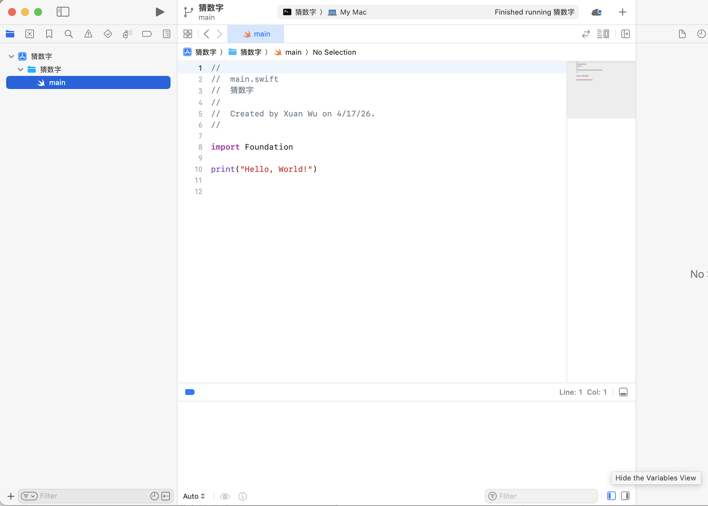
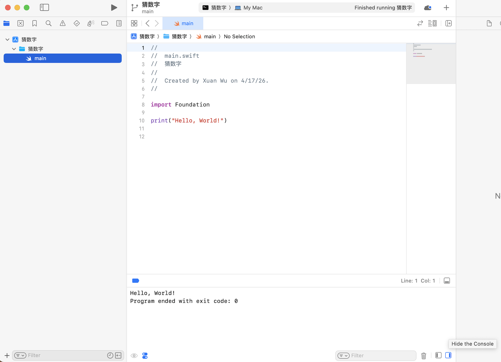
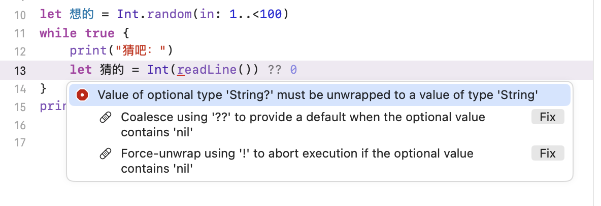
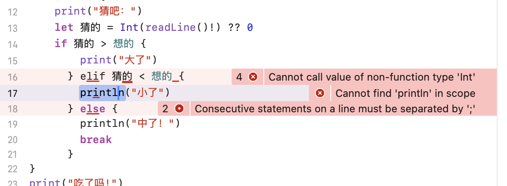

https://zhuanlan.zhihu.com/p/2028635723314602654

发现六年多前的浅尝辄止：[【有彩蛋】Swift 语言官方入门例程中文化（下）](https://www.geeksforgeeks.org/swift/swift-hello-world-program/)

在macOS 15.1.1下装了老版xcode16.2，结果第一个例程运行就吃了个憋，找不到输出：



搜了一下仔细看截图才发现右下角有个不起眼的小按钮“Hide the Console"：



仍用[猜数字](https://gitee.com/MulanRevive/mulan-rework/blob/master/%E6%96%87%E6%A1%A3/%E7%94%A8%E6%88%B7%E6%89%8B%E5%86%8C/%E7%BC%96%E7%A8%8B%E6%96%B0%E6%89%8B/1%E7%8C%9C%E6%95%B0%E5%AD%97.md)练手，[语言文档有中文版](https://doc.swiftgg.team/documentation/the-swift-programming-language/guidedtour/)不错。改写时，找不到如何获取输入、随机数、类型转换等，语言文档的搜索非全文范围。后在[标准库文档](https://developer.apple.com/documentation/swift/swift-standard-library)找到，貌似可全文搜索。

```swift
import Foundation

let 想的 = Int.random(in: 1..<100)
while true {
    print("猜吧：", terminator: "")
    let 猜的 = Int(readLine()!) ?? 0
    if 猜的 > 想的 {
        print("大了")
      } else if 猜的 < 想的 {
        print("小了")
      } else {
        print("中了！")
        break
      }
}
```

## 几个小发现

- 1..<100 的范围表示和[木兰的左闭右开区间](https://zhuanlan.zhihu.com/p/157251383)类似
- 报错信息还比较详尽，但两个fix误会成了两种修正方式，后发现都需要：



- 一行中多个报错时，定位有很大空间，尤其对新手：


 
- xcode不支持中文界面：


 
- 输入太快结果输出没来得及换行，于是加了结束符（terminator）参数：


